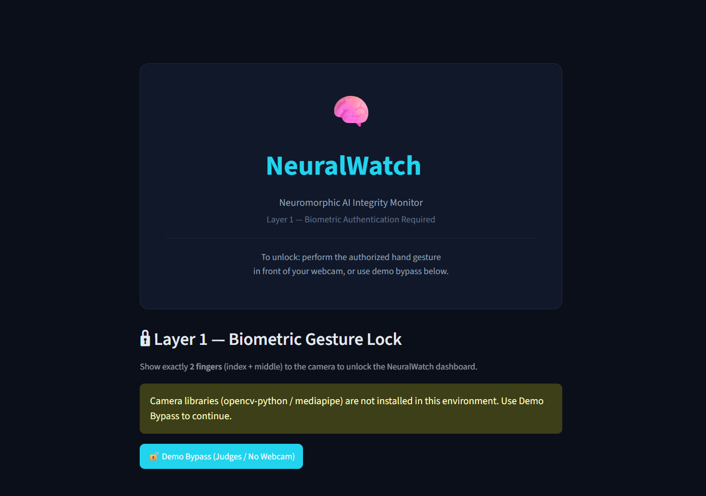
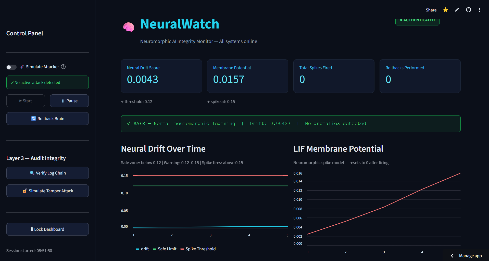
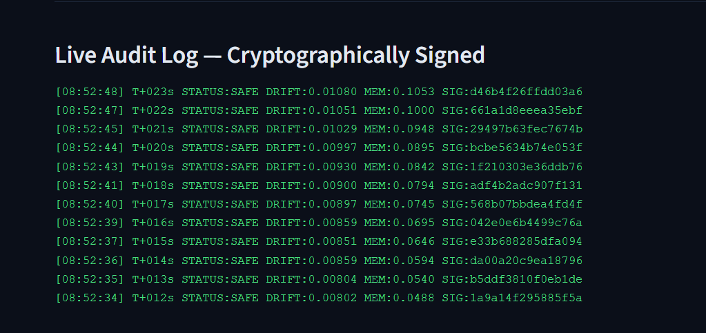
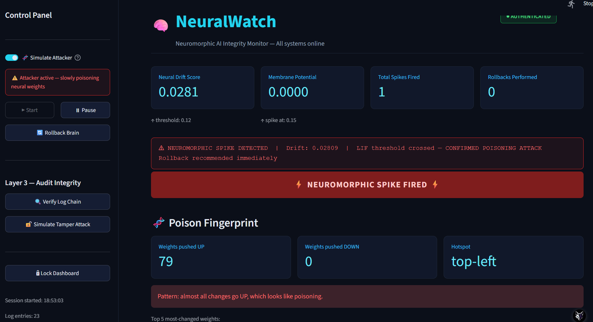
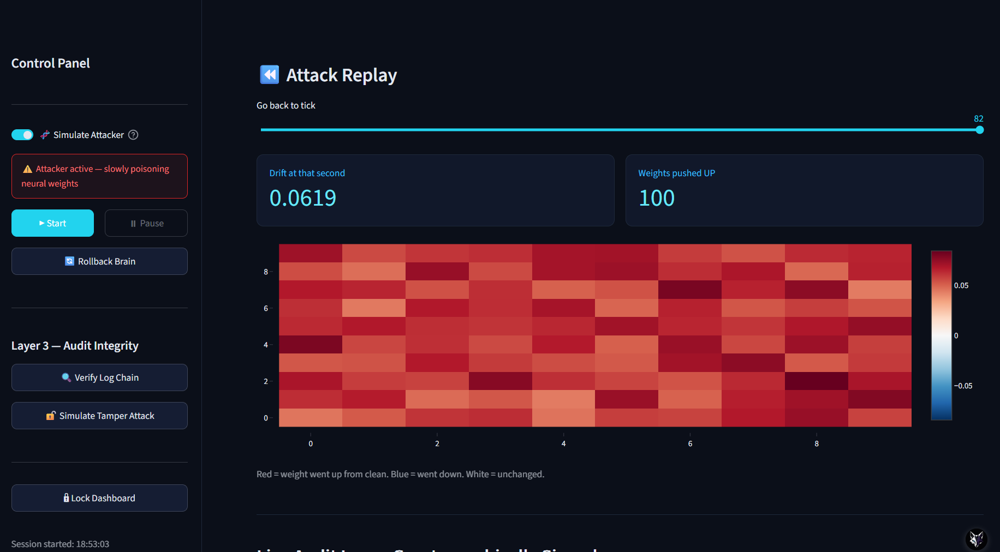
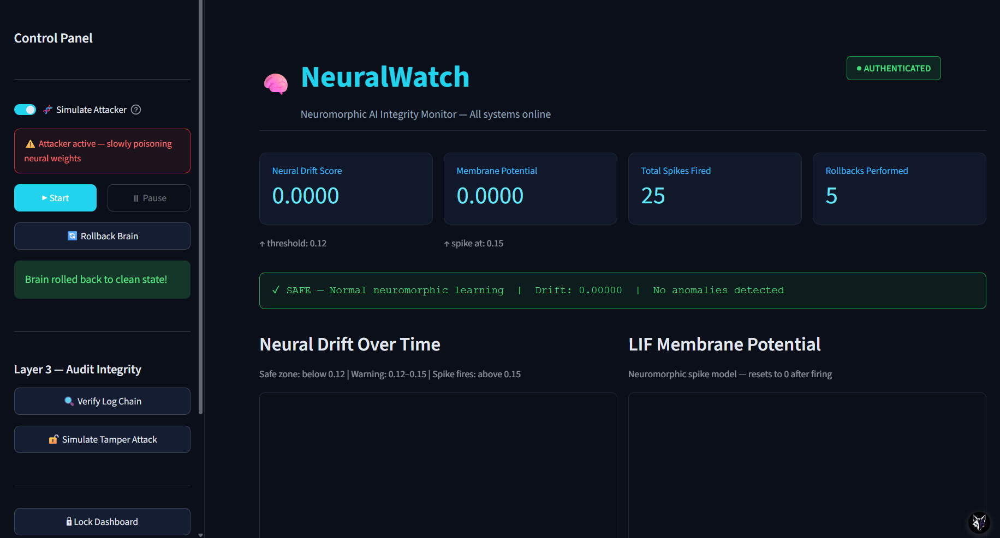
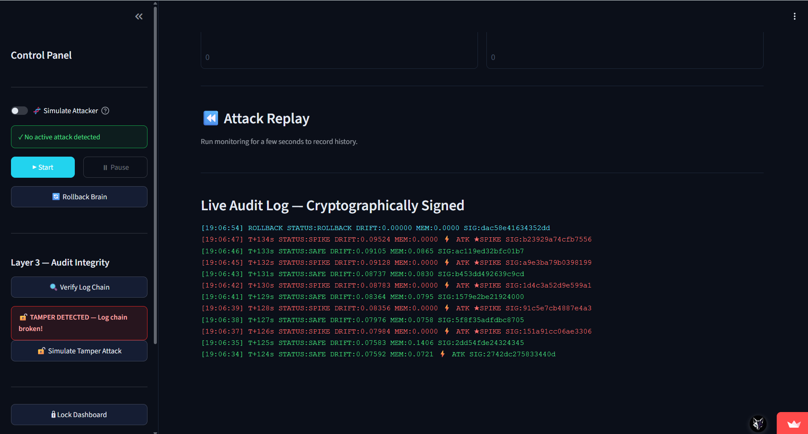
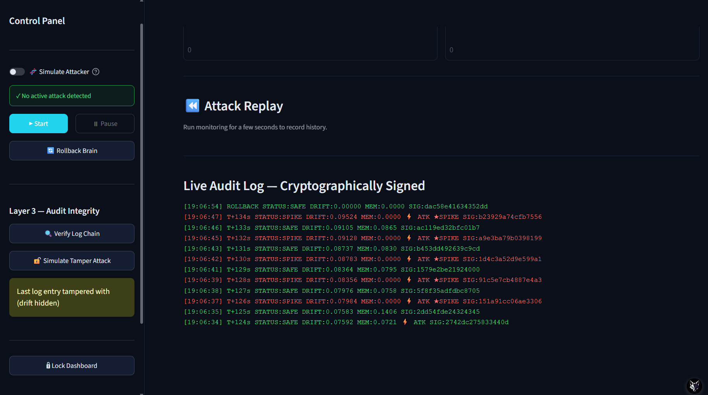

# 🧠 NeuralWatch
### Neuromorphic AI Integrity Monitoring & Cybersecurity Platform

[](https://neuralwatch-vv3lpllqcyifqmgcmpqw6a.streamlit.app/)

**NeuralWatch is a neuromorphic-inspired AI security monitoring prototype designed to explore model-weight drift detection, simulated poisoning attacks, attack replay, poison fingerprint tracking, and tamper-evident audit logging.**

Instead of monitoring only network traffic and external system activity, NeuralWatch explores an additional security surface: the internal integrity of machine learning models.

Developed by **Team VECTRACE** for **NEURONEX'26 — Neuromorphic Computing Track** at VIT Bhopal University.

---

## 🚀 Project Overview

Machine learning models can be manipulated through poisoned training data, malicious parameter modifications, and unauthorized changes to model behaviour.

Such attacks can be difficult to identify when individual parameter changes appear insignificant.

NeuralWatch explores a temporal approach to identifying suspicious changes by monitoring model-weight drift and applying **Leaky Integrate-and-Fire (LIF) neuron dynamics**.

The platform combines:

- Neuromorphic-inspired drift detection.
- Simulated poisoning and attack scenarios.
- Poison fingerprint tracking.
- Attack Replay for repeatable demonstrations.
- Monitoring metrics and visualization.
- Gesture-based dashboard authentication.
- SHA-256 chained audit logging.
- Trusted checkpoint restoration and rollback.

---

## 🏗️ System Architecture

NeuralWatch follows a modular architecture that separates monitoring, authentication, attack simulation, and integrity verification.

```text
                 ┌──────────────────────────┐
                 │      Streamlit UI        │
                 │   Monitoring Dashboard   │
                 └────────────┬─────────────┘
                              │
                 ┌────────────▼─────────────┐
                 │   Gesture Authentication│
                 │     MediaPipe / OpenCV   │
                 └────────────┬─────────────┘
                              │
                 ┌────────────▼─────────────┐
                 │      Neural Brain        │
                 │   Model Weight Monitor   │
                 └────────────┬─────────────┘
                              │
                 ┌────────────▼─────────────┐
                 │    LIF Drift Detection   │
                 │  Membrane / Leak / Spike │
                 └────────────┬─────────────┘
                              │
                 ┌────────────▼─────────────┐
                 │    Attack Simulation     │
                 │   Poison Fingerprints    │
                 │      Attack Replay      │
                 └────────────┬─────────────┘
                              │
                 ┌────────────▼─────────────┐
                 │   Metrics & Alerting     │
                 │   Drift Visualization    │
                 └────────────┬─────────────┘
                              │
                 ┌────────────▼─────────────┐
                 │   SHA-256 Audit Chain    │
                 │   Integrity Verification│
                 └────────────┬─────────────┘
                              │
                 ┌────────────▼─────────────┐
                 │   Trusted Checkpoints   │
                 │     Brain Rollback      │
                 └──────────────────────────┘
```

---

## ⚡ Core Features

### 1. Neuromorphic Drift Detection

**Core innovation of NeuralWatch**

NeuralWatch implements a Leaky Integrate-and-Fire (LIF)-inspired mechanism to monitor suspicious changes in model weights.

The mechanism explores two different behaviours:

- Normal parameter variation: Small changes that decay through the leakage mechanism.
- Persistent directional drift: Repeated changes that accumulate membrane potential and may trigger an alert.

#### LIF Membrane Dynamics

\[
V_t = \lambda V_{t-1} + I_t
\]

Where:

- \(V_t\): Current membrane potential.
- \(\lambda\): Membrane retention factor.
- \(I_t\): Incoming drift signal.

When membrane potential exceeds a configurable threshold, the system generates an alert.

```python
membrane_potential += drift_signal
membrane_potential *= (1 - leak_rate)

if membrane_potential > threshold:
    fire_alert()
    membrane_potential = 0
```

The central idea is that individual weight changes may be insignificant, but persistent directional changes over time can indicate suspicious behaviour.

### 2. Poison Fingerprint Tracking

Introduced during the October 2026 development updates, poison fingerprint tracking extends the monitoring workflow beyond basic drift detection.

This functionality supports tracking suspicious model changes associated with simulated poisoning scenarios.

It provides an additional mechanism for inspecting and identifying changes during attack simulations.

### 3. Attack Replay

NeuralWatch includes an **Attack Replay** capability, added and successfully tested on October 30, 2026.

Attack Replay supports repeatable demonstrations of attack scenarios, allowing users to observe the monitoring workflow under controlled conditions.

It helps demonstrate:

- Simulated attack behaviour.
- Changes in model-weight drift.
- Neuromorphic membrane accumulation.
- Alert generation.
- Monitoring and investigation workflows.

### 4. Monitoring Metrics & Visualization

NeuralWatch integrates monitoring metrics into its interactive dashboard.

The interface provides visual feedback about monitoring activity and detection behaviour, making it easier to inspect the system during normal operation and simulated attacks.

### 5. Gesture-Based Authentication

**Technologies: MediaPipe + OpenCV**

The dashboard includes webcam-based gesture authentication.

Features include:

- Hand landmark detection using MediaPipe.
- Recognition of a predefined hand gesture.
- Gesture hold-duration verification.
- Local webcam processing.
- Safe camera fallback behaviour.
- Demo Bypass for environments without webcam access.

### 6. Tamper-Evident Audit Logging

NeuralWatch uses SHA-256 hash chaining to maintain an integrity-verifiable sequence of monitoring events.

Each audit entry incorporates the hash of the previous entry.

Conceptual implementation:

```python
entry_hash = sha256(
    current_event + previous_hash
).hexdigest()
```

If an existing entry is modified, subsequent hash verification can reveal inconsistencies in the chain.

The audit mechanism provides tamper evidence rather than guaranteeing protection against an attacker capable of rewriting the entire log.

### 7. Trusted Checkpoint & Brain Rollback

NeuralWatch incorporates checkpoint-based recovery to restore a previously trusted model state.

The rollback workflow is designed to recover from simulated poisoning or manipulation scenarios.

The October 30 development updates also included improvements to fingerprint handling and rollback behaviour.

---

## 🔬 How Neuromorphic Computing Powers NeuralWatch

NeuralWatch maps biological neuron behaviour to AI integrity monitoring.

| Biological Neuron | NeuralWatch |
|---|---|
| Synaptic input | Model weight drift signal |
| Membrane potential | Accumulated drift |
| Membrane leakage | Drift signal decay |
| Firing threshold | Detection threshold |
| Action potential | Security alert |
| Reset mechanism | Membrane reset |

The research question behind this implementation:

**Can temporal accumulation of suspicious model-weight changes help identify manipulation patterns that may not be apparent when individual changes are evaluated independently?**

NeuralWatch explores this concept using LIF-inspired dynamics.

---


## 📸 Application Walkthrough — End-to-End Workflow

NeuralWatch demonstrates how a neuromorphic AI integrity monitoring system can monitor neural activity, simulate attacks, track suspicious weight modifications, recover from a clean checkpoint, and verify audit-log integrity.

The following walkthrough presents the complete application workflow in chronological order.

### Step 1: Gesture-Based Authentication

**What happens:**  
The user opens NeuralWatch and reaches the login interface. The application uses a gesture-based authentication mechanism with MediaPipe and OpenCV. A two-finger gesture can be used to authenticate, while Demo Bypass is available for demonstration purposes.

**What this demonstrates:**  
The application's gesture-based access interface.



---

### Step 2: Initialize the Monitoring Dashboard

**What happens:**  
After entering the application, the user accesses the main monitoring dashboard. NeuralWatch displays important monitoring metrics, including:

- Neural drift score
- Membrane potential
- Spike count
- Rollback count
- Monitoring graphs and visualizations

**What this demonstrates:**  
The baseline monitoring interface used to observe the system's neural activity.



---

### Step 3: Monitor the Cryptographic Audit Log

**What happens:**  
NeuralWatch maintains a timestamped audit trail of system events. Each entry is linked through SHA-256 hash chaining.

**What this demonstrates:**  
How system events are recorded to support audit-log integrity verification.



---

### Step 4: Simulate an Attack on Neural Weights

**What happens:**  
The user activates the simulated attacker. The application modifies neural weights in a controlled demonstration environment.

NeuralWatch displays monitoring information such as drift score, spike activity, weight-change direction, and poison fingerprint tracking.

**What this demonstrates:**  
How the application visualizes suspicious weight modifications during a simulated attack.



---

### Step 5: Replay and Investigate the Attack

**What happens:**  
The user opens Attack Replay and moves through the attack timeline to inspect changes over time.

A heatmap visualizes weight modifications:

- Red: increased weights
- Blue: decreased weights
- White: unchanged weights

**What this demonstrates:**  
How users can investigate the progression and distribution of simulated weight modifications.



---

### Step 6: Restore the Clean Checkpoint

**What happens:**  
After the simulated attack, the user triggers checkpoint rollback. NeuralWatch restores the neural brain to a previously saved clean checkpoint.

The dashboard displays the rollback confirmation and updated monitoring metrics.

**What this demonstrates:**  
The checkpoint-based recovery mechanism for reversing simulated malicious weight modifications.



---

### Step 7: Simulate Audit-Log Tampering

**What happens:**  
The user activates the audit-log tampering demonstration. An existing audit entry is modified to simulate unauthorized changes.

**What this demonstrates:**  
How modifying a hash-chained audit entry can compromise the integrity of the log.



---

### Step 8: Detect the Modified Audit Entry

**What happens:**  
The integrity-verification mechanism checks the audit-log chain. The simulated modification causes a hash-chain mismatch, and the application displays a tampering warning.

**What this demonstrates:**  
How hash-chain verification can reveal modifications to previously recorded audit entries.



---

### Complete Workflow

**Authenticate → Monitor → Record Events → Simulate Attack → Detect → Replay → Rollback → Verify Audit Integrity**

NeuralWatch brings together experimental neuromorphic monitoring, attack simulation, checkpoint recovery, and cryptographic audit logging in one interactive prototype.


---

## 🛠️ Technology Stack

| Component | Technology | Purpose |
|---|---|---|
| Programming Language | Python 3.10+ | Core implementation |
| Dashboard | Streamlit | Interactive monitoring interface |
| Numerical Computing | NumPy | Numerical operations and weight simulation |
| Neuromorphic Model | LIF-inspired dynamics | Temporal drift monitoring |
| Gesture Recognition | MediaPipe | Hand landmark detection |
| Computer Vision | OpenCV | Webcam processing |
| Cryptographic Logging | hashlib / SHA-256 | Audit hash generation and verification |
| Version Control | Git & GitHub | Source control |
| Deployment | Streamlit Community Cloud | Hosted demonstration |

---

## 📂 Project Structure

```text
NeuralWatch/
│
├── dashboard.py
├── neural_brain.py
├── neuralwatch.py
├── gesture_lock.py
│
├── requirements.txt
├── README.md
│
└── assets/
    ├── login.png
    ├── dashboard.png
    ├── spike.png
    └── auditlog.png
```

*The directory tree is representative. Refer to the repository for the latest file structure.*

---

## 💻 Installation & Setup

### Prerequisites

- Python 3.10+
- Git
- Webcam (optional, for gesture authentication)

### 1. Clone the repository

```bash
git clone https://github.com/caliancodess20/NeuralWatch.git

cd NeuralWatch
```

### 2. Install dependencies

```bash
pip install -r requirements.txt
```

### 3. Run the application

```bash
streamlit run dashboard.py
```

### 4. Open the dashboard

```text
http://localhost:8501
```

If webcam access is unavailable, use Demo Bypass if enabled.

### Live Demo

[Launch NeuralWatch on Streamlit](https://neuralwatch-vv3lpllqcyifqmgcmpqw6a.streamlit.app/)

### GitHub Repository

[View NeuralWatch Source Code](https://github.com/caliancodess20/NeuralWatch)

---

## 🔐 Security Considerations & Limitations

NeuralWatch is an experimental cybersecurity prototype.

- Drift detection requires calibration against realistic model training behaviour.
- Normal training can also produce directional weight changes.
- Simulated attacks do not establish effectiveness against real-world poisoning attacks.
- Poison fingerprint tracking requires further validation against different attack types.
- Gesture authentication is a prototype access-control mechanism, not a replacement for enterprise identity management.
- SHA-256 chaining provides tamper evidence but does not independently prevent complete log replacement.
- Checkpoint security depends on protecting the trusted baseline.
- Production deployment would require stronger access controls, monitoring, and security validation.

---

## 🔭 Future Scope

- Integration with real machine learning training pipelines.
- Evaluation against established poisoning and backdoor attack datasets.
- Detection accuracy and false-positive benchmarking.
- Adaptive LIF threshold calibration.
- Advanced poison fingerprint analysis.
- Expanded attack replay scenarios.
- Protected checkpoint storage.
- External tamper-resistant audit infrastructure.
- Exploration of neuromorphic hardware deployment.

---

## 📚 References

- [Intel Neuromorphic Computing Research](https://www.intel.com/content/www/us/en/research/neuromorphic-computing.html)
- [MITRE ATLAS – Adversarial Threat Landscape for AI Systems](https://atlas.mitre.org/)
- [NIST AI Risk Management Framework](https://www.nist.gov/itl/ai-risk-management-framework)
- [MediaPipe Hand Landmarker](https://developers.google.com/mediapipe/solutions/vision/hand_landmarker)
- [Integrate-and-Fire Models – Scholarpedia](http://www.scholarpedia.org/article/Integrate-and-fire_models)

---

## 👩‍💻 Team VECTRACE

**NEURONEX'26 | Cybersecurity | Neuromorphic Computing**

**Institution:** VIT Bhopal University  
**Branch:** CSE (Artificial Intelligence & Machine Learning)  
**Academic Year:** First Year

| Team Member | Contributions |
|---|---|
| **Sanskruti Chanekar** | Project ideation, security architecture, dashboard development, Attack Replay implementation and testing, Poison Fingerprint Tracking, monitoring metrics integration, audit logging, threat simulation, and checkpoint rollback improvements |
| **Anwesha Dhote** | Project ideation, neuromorphic research, AI integrity monitoring, LIF-based Neuromorphic Drift Detection, security architecture, core backend & system architecture, main dashboard structure & UI design, threat simulation logic, audit logging system, checkpoint rollback, API/metrics integration, mathematical modeling for weight drift, and core algorithmic integration. |
| **Saumya Sinha** | Project ideation, system integration, gesture authentication, implementation, and testing |

---

## 💡 Project Vision

NeuralWatch explores a different perspective on cybersecurity: protecting not only the infrastructure running an AI system, but also the integrity of the model itself.

By combining neuromorphic-inspired monitoring, attack simulation, poison fingerprint tracking, cryptographic audit logging, and checkpoint-based recovery, NeuralWatch demonstrates an experimental approach to AI integrity monitoring.

**Monitor the model. Detect suspicious drift. Preserve AI integrity.**
